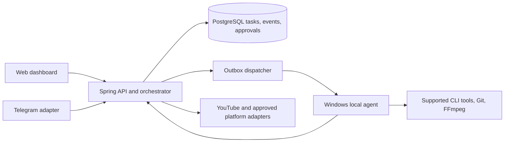

# CreatorFlow V2 architecture

## Current implemented P4 boundary (2026-11-06)

V15/V16 add append-only manifest/artifact/audit evidence and separate publication approvals over existing publication jobs. Canonical typed JSON binds successful current render/video, source provenance, SHA/size/decode evidence, metadata, target, explicit visibility, intended schedule and exact connection ID/generation. Credential/scope/status/revocation changes rotate generation. Job metadata changes atomically invalidate approval; historical approved_at and P3 fixture approvals never authorize publishing.

`PublicationSafety` is the sole upload owner for manual/scheduler/retry dispatch and recovery. It validates the real feature flag, provider/scope/account, immutable manifest/approval/expiry, current sources and rehashed media; locks and claims the canonical target, then issues a private-constructor dispatch permit. A bounded hashed OS-locked staged snapshot supplies the upload body, with rechecks before init/after token refresh/before PUT. YouTube uses approved visibility and exact connection revision; confirmation matches post ID and visibility. Pre-transfer failure may retry through the same gate; uncertain transfer/restart without ID quarantines and cannot blindly resend. Known IDs can be confirmed without another upload. All real acceptance flags remain false; mock transport is explicit test construction on loopback, not a frontend/runtime bypass.

The existing Publication Queue links to a real-backend review page with authenticated checksum-checked preview, immutable revision details/diffs, exact approve/reject/revoke/invalidate controls, readiness, reconciliation and audit. Agent identities cannot access publication review; local operator authentication remains single-operator. Telegram fixture routing/approvals remain unchanged and do not gain publication authority. No new live social adapter, public ingress, autonomous executor or schedule is added.

Actual contracts, side-effect call-path audit, tests and conservative reconciliation/approval limits: [P4_CONTENT_APPROVAL.md](P4_CONTENT_APPROVAL.md). Next is an operator-reviewed V2-P5-01 design/implementation cycle for credential lifecycle, isolated coding worktrees, explicit AI task/capability/quota admission and draft-PR review gates; it is not implemented in P4. Older phase snapshots below remain historical context.

Updated 2026-11-06. P0, Account Manager, local agent, P2 dependency cycles/checkpoints/handoff, read-only Codex monitoring and P3 Telegram control/outbox are **IMPLEMENTED**, with scoped tests in PROJECT_STATUS.md. Telegram acceptance is MOCK_ONLY; live bot is NOT_CONFIGURED. Autonomous coding and general AI task execution remain **DESIGNED**.

## Implemented P3 boundary

Telegram -> long-poll adapter -> authenticated numeric command dispatcher -> Spring services -> PostgreSQL cycles/task queue -> existing Windows Agent. No public webhook/API port is added. TELEGRAM_ENABLED defaults false; backend environment owns tokens, PostgreSQL owns non-secret identity/routing metadata, durable poll leases/offsets/update receipts and control state. Separate workers keep long polling off the agent recovery scheduler. Operator HTTP credentials and agent-runtime credentials remain separate; agents cannot access Telegram management APIs.

V13/V14 persist cycle states/controls/events, assigned expiring fixture approvals and transactional outbound rows. Claim and control serialize through the same agent lock; pause gates new claims, cancel uses existing attempt/session fencing and cannot resurrect after restart. Event triggers atomically enqueue sanitized ID/type notifications for CODE, CONTENT and VIDEO. Send claims have bot/chat budgets, bounded retries and dead-letter/UNKNOWN quarantine; an ambiguous send is never blindly replayed. The provider does not offer exactly-once send semantics.

Telegram commands require both registered chat and numeric user; OPERATOR/ADMIN plus route flags gate mutations. Bot senders, anonymous senders and deep replies are ignored; response frequency and command set are bounded. `/usage` reads existing PostgreSQL quota/freshness only. Approval binds fixture cycle, action, operator, bot/chat, expiry and evidence; duplicate/replayed decisions cannot change terminal state and never publish. UI `/telegram` reads real backend metadata and validates routing without sending. Official bot-to-bot mode is documented but not assumed/enabled; executor/reviewer remain future roles.

Actual database/security/concurrency/mock HTTP, real Windows fixture/control, process restart and Playwright evidence are in [TELEGRAM_INTEGRATION.md](TELEGRAM_INTEGRATION.md). Existing P2 implementation below is preserved. P4/P5 require immutable action/evidence manifests, isolated coding worktrees, credential lifecycle, verified provider capabilities, fresh quota admission/operator gates and review/test-gated draft PRs; no autonomous executor or five-hour trigger is introduced.

## Implemented P2 boundary

P2-01 -> P2-02 -> P2-03 is preserved. V10 adds bounded validated DAGs over the existing queue, dependency-aware claim, failure propagation and bounded retry/backoff. V11 adds owner/session/attempt/lease-fenced immutable checkpoints; the Windows agent verifies artifact hashes/Git refs before reuse. Settled cycles generate handoffs from committed DB state, atomically exported per-cycle/latest under ignored storage. They never race the source writer by overwriting tracked navigation; unknown checkout branch/commit/files remain unavailable rather than invented.

V12 stores allowlisted usage snapshots and refresh intents tied to authenticated agent identity/session. A separate read-only agent collector thread checks CLI version/public schema and initializes App Server stdio before rate-limit/optional token reads, merging available notifications. No inference, login, switching, reset-credit consumption or provider auth-file access/copy occurs. Raw protocol errors, emails/account IDs, prompts and secrets are discarded at the collector boundary and rejected by ingestion schema. Agent and operator APIs remain separate.

Provider polling defaults to 180 seconds. Backend freshness derives from observation age, failures/reset deadlines and refresh timeout; duplicate/out-of-order reports cannot replace newer observations. Match five-hour/seven-day windows by duration 300/10080, not primary/secondary. Missing windows stay NOT_AVAILABLE; credits/token activity remain nullable facts, never an invented quota denominator. Configurable warnings/readiness support future AI admission without blocking quota-free fixtures.

React `/ai-usage` and a compact Account Manager widget render real backend progress/reset/countdown, source/agent, history and manual refresh. Gemini is UNSUPPORTED and OpenRouter UNKNOWN pending official adapters. Codex 0.162.1 was LIVE_VERIFIED through the actual local agent/backend/browser path; fixture tests remain MOCK_ONLY. Protocol, limits and acceptance: [P2_ENGINE_USAGE.md](P2_ENGINE_USAGE.md).

## Implemented local agent boundary

`React /agents -> Spring AgentApi/AgentQueue -> PostgreSQL V9 <- independently running Windows Python agent` is implemented. Registration uses a separate enrollment secret, followed by a scoped agent credential whose hash/metadata alone live in PostgreSQL; its local copy is Windows DPAPI encrypted. The browser token cannot claim tasks; the agent token cannot call browser/operator APIs. No provider auth cache is opened or copied.

V9 owns `local_agents`, `agent_credentials`, `agent_tasks` and `agent_task_events`. Atomic `SKIP LOCKED` claim, per-agent/worktree partial unique indexes, session/attempt/lease fencing, idempotency keys, cancellation and bounded expired-lease recovery are implemented. Task transition events commit transactionally; an outbox dispatcher is not implemented. The first runtime executes one targeted fixed fixture task per agent, with filesystem writer locks and Windows Job Object process-tree cleanup. Only Git fixture, FFmpeg fixture and capability probe are supported. There is no general command executor or coding worktree writer.

Actual Windows process tests and E2E (including agent/backend restarts) passed; see [LOCAL_AGENT.md](LOCAL_AGENT.md) for commands, protocol, evidence and limits. Keep transport on loopback. A Windows service installer, remote/multi-tenant identity, arbitrary coding tasks and checkpointed dependency execution are not implemented.

## Existing boundary

`React/Vite -> Spring Boot modular monolith -> PostgreSQL + local media` is implemented. Spring controllers own business actions; Flyway owns schema. FFmpeg and Windows System Speech run locally. YouTube OAuth/publisher exists but live publishing is disabled by default. V2 extends this system rather than replacing its API families.

## Target component flow

The first V2 deployment remains one backend process plus one optional local agent. The backend assigns a lease with `task_id`, `attempt`, `lease_expires_at` and `idempotency_key`; the agent heartbeats and checkpoints progress. A lease claim uses `FOR UPDATE SKIP LOCKED`. Every task result is compared with its attempt number so a late result cannot overwrite a newer attempt. Events are written in the same transaction as task transitions and delivered from an outbox. All command, media and publication operations are bounded and auditable.

## Target account and execution model (deployed contracts are in ACCOUNT_MANAGER.md and LOCAL_AGENT.md)

`provider_accounts` stores provider, display label, capabilities, connection state, expiry and encrypted token reference when permitted. Raw credentials never appear in task payloads, frontend responses, logs or handoffs. Reconnect opens an official provider flow. Capability probes return `SUPPORTED`, `UNSUPPORTED` or `UNKNOWN` per installed tool/version. The local agent may use an existing user-authenticated CLI session only through documented supported commands; backend never copies CLI auth caches or silently swaps profiles. Gemini CLI's documented headless mode uses cached auth or configured API key/Vertex credentials; Codex exposes supported automation surfaces, including `codex exec`, SDK and app-server. These facts do not establish multi-account switching. See [Gemini CLI authentication](https://github.com/google-gemini/gemini-cli/blob/main/docs/get-started/authentication.mdx) and [Codex platform guidance](https://developers.openai.com/blog/codex-as-a-platform).

Proposed tables, added only after P0: `provider_accounts(id, provider, label, state, expires_at, last_checked_at, capability_json, encrypted_token_ref, revoked_at)`, `local_agents(id, host_fingerprint, version, state, last_heartbeat_at, capability_json)`, `agent_tasks(id, kind, state, attempt, max_attempts, lease_owner, lease_expires_at, idempotency_key, worktree_key, input_json, result_json, error_code)`, `task_dependencies(task_id, depends_on_id)`, `task_events(id, task_id, sequence, type, payload_json, created_at)` and `outbox_events(id, aggregate_id, event_type, payload_json, delivered_at)`. Unique `(task_id, sequence)`, unique `idempotency_key` and a partial unique active `worktree_key` prevent common duplicate effects. Token ciphertext and key rotation metadata must be separated from public account metadata.

Proposed API additions, versioned under `/api/v2`: account inventory and reconnect intent; agent registration/heartbeat/task claim/checkpoint/result; workflow task/dependency reads; approval decisions; and handoff metadata. No existing `/api/*` V1 route is repurposed. Agent authentication needs a distinct scoped credential; the current browser bearer token must not authorize agent claims or account decryption. A later multi-user deployment requires a real identity model before remote access.

An agent reports host identity, version, capabilities and heartbeat. It receives one leased task at a time initially. Pause prevents new claims; cancel requests process termination and records an outcome; resume requeues from a committed checkpoint. Git write tasks allocate a unique worktree path and lock key. Review/test tasks can read the worktree but cannot write concurrently. `main` merge and production deploy have separate explicit approval gates.

## Workflow and messaging

Task graph: `Planner -> Executor -> Reviewer -> Tests -> PR draft`, with a separate content graph `Topic -> Script -> Storyboard -> Assets -> Voice -> Render -> QA -> Approved Publication`. Nodes persist dependencies, attempts, deadlines, artifacts and evidence. Reviewer failure creates a new executor attempt with bounded backoff. Publisher nodes require an immutable approved artifact hash and account/scope check immediately before sending.

Telegram CODE, CONTENT and VIDEO groups are routing views over backend events. Each update ID is deduplicated in PostgreSQL. Use either long polling or webhook for a bot; for webhook deployment, validate Telegram's secret header and require HTTPS. Telegram is never the only record of a decision. See the [Telegram Bot API](https://core.telegram.org/bots/api). No bot is configured or contacted in V2 P0.

## Publishing and recovery

Keep the existing YouTube OAuth implementation behind `CREATORFLOW_ENABLE_REAL_PUBLISH`. Store the provider's post ID and reconcile ambiguous uploads before retrying. TikTok Direct Post requires approved `video.publish` scope, user authorization and platform app review; until those gates are met, the adapter must fail closed. See [TikTok Direct Post prerequisites](https://developers.tiktok.com/docs/en/content-posting-api-get-started). No automatic public post is part of this design.

The five-hour schedule is optional and disabled by default. A unique cycle key prevents overlap across restarts. Each cycle writes a handoff after its tasks settle or block. The handoff is a navigation aid; PostgreSQL, Git and test artifacts remain the evidence sources.

## Historical P0 risks (superseded by current P0 acceptance and LOCAL_AGENT.md)

- V1 auth is a single local bearer token, with no per-user roles or audit actor. Do not expose the backend or Vite proxy publicly.
- Publication scheduling currently ignores `FAILED` jobs in its duplicate lookup; P0 must reconcile that path before any live provider enablement.
- Render and publication workers run in the API process. Publication `PUBLISHING` with an unknown upload result requires operator reconciliation; blind retry risks duplicate posts.
- AI generation is synchronous and records success before storyboard JSON validation. Retry/backoff and durable provider job recovery are incomplete.
- Asset upload checks signatures but does not prove media can be decoded before it is assigned to a scene.
