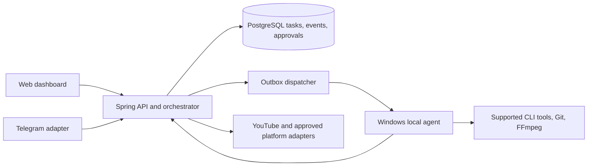

# CreatorFlow V2 architecture

Status: **DESIGN**, except the V1 components explicitly identified below. Updated 2026-11-05.

## Existing boundary

`React/Vite -> Spring Boot modular monolith -> PostgreSQL + local media` is implemented. Spring controllers own business actions; Flyway owns schema. FFmpeg and Windows System Speech run locally. YouTube OAuth/publisher exists but live publishing is disabled by default. V2 extends this system rather than replacing its API families.

## Target component flow

The first V2 deployment remains one backend process plus one optional local agent. The backend assigns a lease with `task_id`, `attempt`, `lease_expires_at` and `idempotency_key`; the agent heartbeats and checkpoints progress. A lease claim uses `FOR UPDATE SKIP LOCKED`. Every task result is compared with its attempt number so a late result cannot overwrite a newer attempt. Events are written in the same transaction as task transitions and delivered from an outbox. All command, media and publication operations are bounded and auditable.

## Account and execution model

`provider_accounts` stores provider, display label, capabilities, connection state, expiry and encrypted token reference when permitted. Raw credentials never appear in task payloads, frontend responses, logs or handoffs. Reconnect opens an official provider flow. Capability probes return `SUPPORTED`, `UNSUPPORTED` or `UNKNOWN` per installed tool/version. The local agent may use an existing user-authenticated CLI session only through documented supported commands; backend never copies CLI auth caches or silently swaps profiles. Gemini CLI's documented headless mode uses cached auth or configured API key/Vertex credentials; Codex exposes supported automation surfaces, including `codex exec`, SDK and app-server. These facts do not establish multi-account switching. See [Gemini CLI authentication](https://github.com/google-gemini/gemini-cli/blob/main/docs/get-started/authentication.mdx) and [Codex platform guidance](https://developers.openai.com/blog/codex-as-a-platform).

Proposed tables, added only after P0: `provider_accounts(id, provider, label, state, expires_at, last_checked_at, capability_json, encrypted_token_ref, revoked_at)`, `local_agents(id, host_fingerprint, version, state, last_heartbeat_at, capability_json)`, `agent_tasks(id, kind, state, attempt, max_attempts, lease_owner, lease_expires_at, idempotency_key, worktree_key, input_json, result_json, error_code)`, `task_dependencies(task_id, depends_on_id)`, `task_events(id, task_id, sequence, type, payload_json, created_at)` and `outbox_events(id, aggregate_id, event_type, payload_json, delivered_at)`. Unique `(task_id, sequence)`, unique `idempotency_key` and a partial unique active `worktree_key` prevent common duplicate effects. Token ciphertext and key rotation metadata must be separated from public account metadata.

Proposed API additions, versioned under `/api/v2`: account inventory and reconnect intent; agent registration/heartbeat/task claim/checkpoint/result; workflow task/dependency reads; approval decisions; and handoff metadata. No existing `/api/*` V1 route is repurposed. Agent authentication needs a distinct scoped credential; the current browser bearer token must not authorize agent claims or account decryption. A later multi-user deployment requires a real identity model before remote access.

An agent reports host identity, version, capabilities and heartbeat. It receives one leased task at a time initially. Pause prevents new claims; cancel requests process termination and records an outcome; resume requeues from a committed checkpoint. Git write tasks allocate a unique worktree path and lock key. Review/test tasks can read the worktree but cannot write concurrently. `main` merge and production deploy have separate explicit approval gates.

## Workflow and messaging

Task graph: `Planner -> Executor -> Reviewer -> Tests -> PR draft`, with a separate content graph `Topic -> Script -> Storyboard -> Assets -> Voice -> Render -> QA -> Approved Publication`. Nodes persist dependencies, attempts, deadlines, artifacts and evidence. Reviewer failure creates a new executor attempt with bounded backoff. Publisher nodes require an immutable approved artifact hash and account/scope check immediately before sending.

Telegram CODE, CONTENT and VIDEO groups are routing views over backend events. Each update ID is deduplicated in PostgreSQL. Use either long polling or webhook for a bot; for webhook deployment, validate Telegram's secret header and require HTTPS. Telegram is never the only record of a decision. See the [Telegram Bot API](https://core.telegram.org/bots/api). No bot is configured or contacted in V2 P0.

## Publishing and recovery

Keep the existing YouTube OAuth implementation behind `CREATORFLOW_ENABLE_REAL_PUBLISH`. Store the provider's post ID and reconcile ambiguous uploads before retrying. TikTok Direct Post requires approved `video.publish` scope, user authorization and platform app review; until those gates are met, the adapter must fail closed. See [TikTok Direct Post prerequisites](https://developers.tiktok.com/docs/en/content-posting-api-get-started). No automatic public post is part of this design.

The five-hour schedule is optional and disabled by default. A unique cycle key prevents overlap across restarts. Each cycle writes a handoff after its tasks settle or block. The handoff is a navigation aid; PostgreSQL, Git and test artifacts remain the evidence sources.

## Current risks to close before V2 agent work

- V1 auth is a single local bearer token, with no per-user roles or audit actor. Do not expose the backend or Vite proxy publicly.
- Publication scheduling currently ignores `FAILED` jobs in its duplicate lookup; P0 must reconcile that path before any live provider enablement.
- Render and publication workers run in the API process. Publication `PUBLISHING` with an unknown upload result requires operator reconciliation; blind retry risks duplicate posts.
- AI generation is synchronous and records success before storyboard JSON validation. Retry/backoff and durable provider job recovery are incomplete.
- Asset upload checks signatures but does not prove media can be decoded before it is assigned to a scene.
